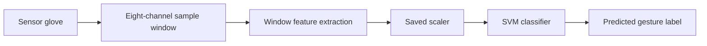

# Manusa

**A sensor glove that turns hand gestures into text.**

Manusa combines a flex-sensor glove, a KiCad sensor board, a machine-learning classifier, and a small HTTP API. The repository is organized by component so the hardware and software can be explored independently.

## Project map

| Component | Location | Contents |
| --- | --- | --- |
| API | [`software/api`](software/api) | FastAPI inference endpoint and serial prediction client |
| Machine learning | [`machine-learning`](machine-learning) | Serving models, feature extraction, a KNN trainer, and its sensor dataset |
| PCB | [`hardware/pcb`](hardware/pcb) | KiCad schematic, board, project, and custom footprint library |
| Mechanical | [`hardware/mechanical`](hardware/mechanical) | STL parts for the glove assembly |
| Documentation assets | [`docs/assets`](docs/assets) | Model figures and label images |

## How the pieces fit

1. The glove sensors provide eight numeric channels per sample: `X`, `Y`, `Z`, and `F1` through `F5`.
2. The API accepts a time window of samples, extracts mean, standard deviation, minimum, and maximum for each channel, then applies the saved scaler and SVM classifier.
3. The API returns a predicted label and confidence value.



The checked-in API model is the window-based SVM and scaler in `machine-learning/models`. The serial client uses a separate KNN pipeline from the same folder.

## Run the API

Use Python 3.13 and install the project dependencies:

```bash
python -m venv .venv
# Windows PowerShell: .venv\Scripts\Activate.ps1
# macOS/Linux: source .venv/bin/activate
python -m pip install -r requirements.txt
```

Start the development server from the repository root:

```bash
python -m uvicorn api:app --app-dir software/api --reload
```

Open `http://127.0.0.1:8000/docs` for the interactive API page.

### Predict a gesture

Send a JSON object with a two-dimensional `values` array. Each row must contain eight numeric sensor readings, in the channel order listed above. The API currently accepts windows of at least five rows; the SVM training experiment used windows of 20 rows.

```bash
curl -X POST http://127.0.0.1:8000/predict \
  -H "Content-Type: application/json" \
  -d '{"values":[[0,0,0,100,100,100,100,100],[0,0,0,101,99,100,102,98],[0,0,0,100,100,101,99,100],[0,0,0,102,101,98,100,99],[0,0,0,99,100,100,98,101]]}'
```

The response contains a `prediction` label and a `confidence` value; confidence is `null` when the loaded classifier has no probability estimates. The serial client is available at `software/api/serial_predict.py`; it reads eight whitespace-separated values from a serial port and uses the KNN pipeline artifact in `machine-learning/models`.

## Hardware

Open `hardware/pcb/FlexSensor_BluetoothBoard/FlexSensor_BluetoothBoard.kicad_pro` with KiCad. The project includes the schematic, board file, project settings, and custom footprints. The two STL files are in `hardware/mechanical`.

## Machine-learning files

- `machine-learning/models`: the SVM and scaler used by the API.
- `machine-learning/training`: the maintained KNN training workflow.
- `machine-learning/data`: the sensor recording used by that workflow.
- `machine-learning/results`: saved metadata and feature bounds from experiments.

The KNN training workflow is documented in [`machine-learning/training`](machine-learning/training). The API's SVM model is provided as a pre-trained artifact. The serialized scikit-learn models were created with scikit-learn 1.8.0; keep that library version aligned when loading or retraining them.

## Repository hygiene

The original virtual environment, KiCad backups, raw photography, historical training experiments, and older datasets are under `local-only/` and ignored by Git. Review the archived experiment scripts before reusing them; they are not part of the maintained workflow. Review the included sensor recording before publishing it.

No microcontroller firmware source was present in the supplied folders, so this repository currently covers the board design, model/API, datasets, and mechanical exports.
